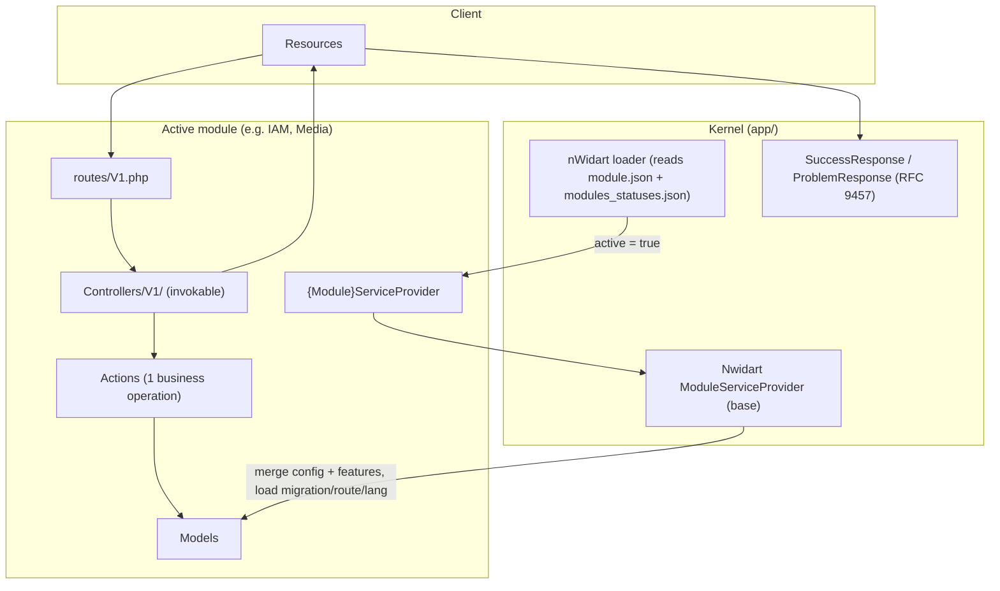
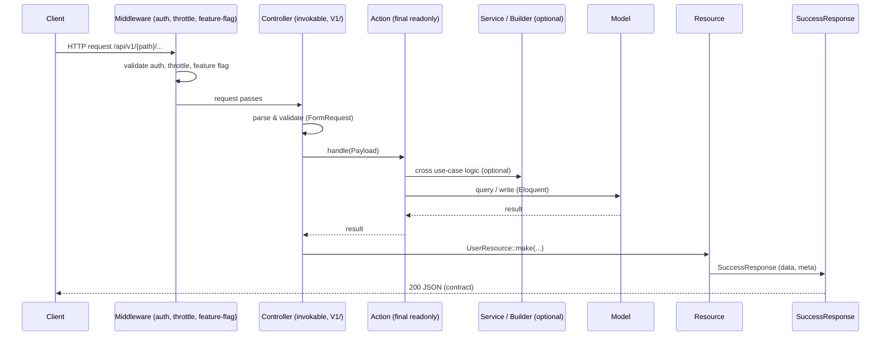
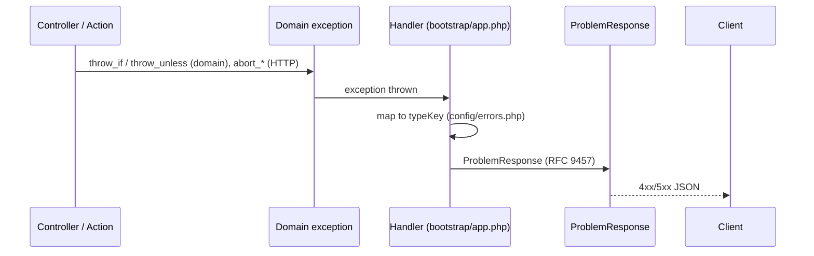
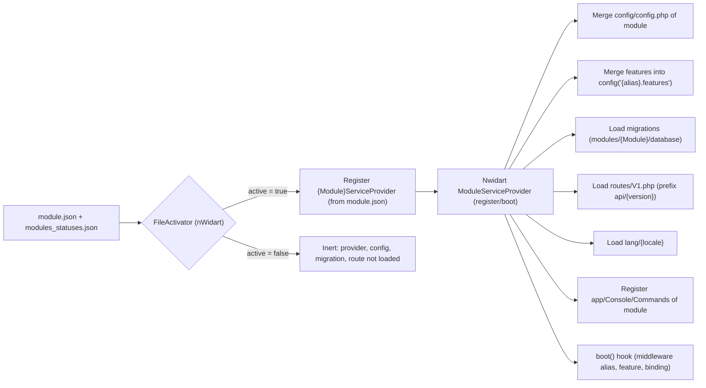
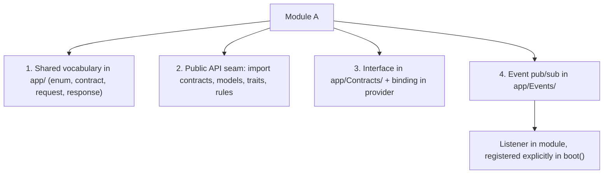
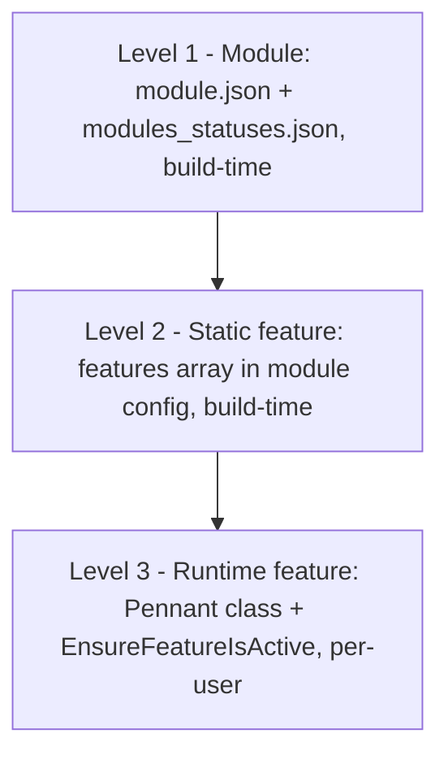
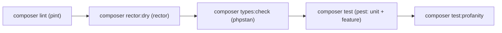

# Modularization Architecture: Laravel Starterkit API

Status: **Final**. This document is the single, canonical architecture document for the Laravel Starterkit API. The enforceable rules live in `tests/Architecture/ArchitectureTest.php` and `.ai/rules/` (they take precedence); this document must stay in sync with them. All decisions are explained directly here.

---

## 1. Executive Architecture Overview & Design Patterns

**This architecture** is a modular Laravel starterkit: every business capability lives inside one self-contained module, managed by the **nWidart/laravel-modules** package (activation via `modules_statuses.json`), and wires itself to the framework through one **service provider** per module.

**Three core ideas:**

- **Modules mirror `app/`** - adopters familiar with the Laravel layout understand a module without extra documentation.
- **Config-driven activation, no env** - no `MODULES_*` env overrides; active status and feature toggles are reviewable code decisions.
- **Native-first** - every wrapper keeps an escape hatch to the built-in Laravel API.

### Architecture Overview



### 1.1 Modules mirror the app structure (mirror principle)

The module folder structure mirrors the built-in `app/` structure, including the container folders `Http/` (Controllers, Middleware, Requests, Resources) and `Console/` (Commands) that host HTTP/CLI layers exactly like `app/Http` and `app/Console`.

- Rules and forbidden items: see [.ai/rules/modules-structure.md](../.ai/rules/modules-structure.md).
- Inspiration: Nuxt Layers ("the layers structure is almost identical to a standard Nuxt application"), official Laravel package structure, nWidart/laravel-modules.

### 1.2 Config-driven activation, no env

Capabilities are enabled through nWidart FileActivator, **not** environment variables.

- `modules_statuses.json` holds the active status of each module (TitleCase module name to boolean), managed via `php artisan module:enable {Module}` / `module:disable`.
- Module metadata (name, alias, priority, providers) lives in the module's own `module.json`.
- The activation is an **allow-list**: modules not enabled are fully inert, no auto-discovery.
- Inspiration: Laravel Fortify (`features` array in `config/fortify.php`), nWidart/laravel-modules (FileActivator).

### 1.3 Single-responsibility actions, wired by providers

- Business logic is an **action class** performing one business operation.
- The **service provider** does the wiring: registers config, actions, and routes to the framework.
- Every module has one provider (`modules/{Module}/app/Providers/{Module}ServiceProvider.php`) extending the nWidart base `Nwidart\Modules\Support\ModuleServiceProvider`.
- The nWidart loader boots providers of **ACTIVE** modules (from `module.json` + `modules_statuses.json`).
- Inspiration: Laravel Fortify (`app/Actions/Fortify/CreateNewUser.php`), nWidart/laravel-modules (one service provider per module).

### 1.4 Self-contained modules

- Migrations, factories, seeders, routes, requests, resources, and tests live inside the module.
- A module can be moved, deleted, or enabled **without touching files outside the module** (except its activation status in `modules_statuses.json`).
- Inspiration: nWidart/laravel-modules.

### 1.5 Shared vocabulary lives in app

- Contracts used across modules (interfaces, shared enums, response contract) live in `app/`.
- Rules and forbidden items: see [.ai/rules/contracts.md](../.ai/rules/contracts.md).
- Inspiration: `shared/` in Nuxt Layers.

### 1.6 No per-module overhead

Deliberate deviation from nWidart/laravel-modules: modules keep the scaffold **minimal** (nWidart requires `module.json` + `composer.json` per module, generated by `module:make`), but custom module code stays close to plain Laravel classes. No per-module `resources/assets`, `vite.config.js`, or duplicated build tooling.

- **One repo, one dependency graph, one build.**
- Philosophy: production-ready, not overengineered.

### 1.7 Native-first escape hatch

- Every customization must preserve the native Laravel path.
- Adopters can always skip the wrapper and use the built-in API.
- Customizations make things easier, never block them.

---

## 2. Request Lifecycle & Data Flow

### 2.1 Successful request flow



### 2.2 Error flow



**Key rule:** errors go through exceptions that the handler maps to `ProblemResponse`; rules: see [.ai/rules/error-handling.md](../.ai/rules/error-handling.md).

### 2.3 Module boot lifecycle



### 2.4 Inter-module communication (4 paths)



---

## 3. Directory Structure & Component Responsibilities

### 3.1 Project folder structure

```text
project/
├── app/                         # Shared code (shared vocabulary)
│   ├── Builders/                # BaseQueryBuilder (filter/sort/search/include whitelist)
│   ├── Concerns/                # Shared traits (HasDefaultBehavior, FormatDate, etc.)
│   ├── Console/
│   │   └── Commands/            # Global Artisan commands (module:make, security:check)
│   ├── Contracts/               # Cross-module interfaces (Identity)
│   ├── Enums/                   # Shared vocabulary enums (RoleEnum, PermissionEnum)
│   ├── Events/                  # Cross-module events (module A dispatches, module B listens)
│   ├── Features/                # Pennant class-based features used by 2+ modules
│   ├── Http/
│   │   ├── Controllers/         # Base Controller
│   │   ├── Middleware/          # Global: AddTraceId, AddSecurityHeaders, SetLocale, AddDeprecationHeaders, HandleIdempotentRequests
│   │   ├── Requests/            # Shared requests (PaginationRequest, BulkActionRequest)
│   │   └── Responses/           # SuccessResponse, ProblemResponse (RFC 9457)
│   ├── Jobs/                    # Queue jobs shared across modules
│   ├── Models/                  # Shared models (Sanctum PersonalAccessToken)
│   ├── Notifications/           # Shared notifications (VerifyEmail, ResetPassword)
│   ├── Payloads/                # Shared DTOs (IdempotencyPayload)
│   ├── Providers/               # AppServiceProvider, RouteServiceProvider
│   └── Support/                 # Global technical utilities (ProductionSecurityCheck)
├── config/                      # Global config (apiroute.php = supported API versions)
├── database/
│   ├── factories/               # Shared factories
│   ├── migrations/              # Shared migrations
│   └── seeders/                 # Shared seeders
├── modules/
│   └── {Module}/                # One module (TitleCase folder, lowercase alias)
│       ├── module.json          # nWidart metadata (name, alias, priority, requires, providers)
│       ├── composer.json        # nWidart scaffold (package metadata)
│       ├── app/                 # Mirrors app/: all module PHP code here
│       │   ├── Http/            # All HTTP layers here
│       │   │   ├── Controllers/ # V1/, V2/ for API versioning (invokable single-action)
│       │   │   ├── Middleware/  # Module-specific middleware
│       │   │   ├── Requests/    # V1/ (FormRequest validation)
│       │   │   └── Resources/   # API resource transformers
│       │   ├── Console/
│       │   │   └── Commands/    # Module-specific Artisan commands
│       │   ├── Exceptions/      # Module-specific exception classes
│       │   ├── Features/        # Module-specific Pennant class-based features (runtime flag)
│       │   ├── Jobs/            # Module-specific queue jobs
│       │   ├── Mail/            # Module-specific mail
│       │   ├── Rules/           # Module-specific custom validation rules
│       │   ├── Events/          # Module-specific events
│       │   ├── Listeners/       # Module-specific listeners
│       │   ├── Lang/            # {locale}/ (module translations, loaded when active)
│       │   ├── Models/          # Module Eloquent models
│       │   │   └── Scopes/      # Global scopes (registered via #[ScopedBy])
│       │   ├── Observers/       # Model observers (registered via #[ObservedBy])
│       │   ├── Policies/        # Module authorization policies (registered via #[UsePolicy])
│       │   ├── Providers/       # (required) {Module}ServiceProvider extends Nwidart base + RouteServiceProvider
│       │   ├── Notifications/   # Module-specific notifications
│       │   ├── Actions/         # Kit-specific: one business operation, final readonly, handle()
│       │   ├── Builders/        # Kit-specific: query builder, extends BaseQueryBuilder
│       │   ├── Services/        # Kit-specific: cross use-case logic
│       │   ├── Payloads/        # Kit-specific: action input DTOs
│       │   ├── Support/         # Kit-specific: pure technical utilities
│       │   ├── Contracts/       # Kit-specific: module-specific contracts
│       │   └── Enums/           # Kit-specific: module-specific enums
│       ├── config/              # Kit-specific: config.php (merged by base provider)
│       ├── database/            # Kit-specific: factories, migrations, seeders
│       ├── routes/              # (required) V1.php, V2.php (loaded by module RouteServiceProvider)
│       └── tests/               # (required) Module feature and unit tests
├── routes/
│   ├── api.php                  # Reserved; API routes registered by modules (routes/V1.php)
│   ├── console.php              # Console routes
│   └── web.php                  # Web routes
└── tests/                       # Global app tests
    ├── Architecture/            # Architecture tests (conventions)
    ├── Feature/                 # Infrastructure tests (middleware, responses, etc.)
    ├── Unit/                    # App unit tests
    └── Helpers.php              # Shared helper seam (module models may be imported directly)
```

**Mirror principle (1.1):** `modules/{Module}/app/` is a mirror of the built-in `app/` skeleton; the container folders `Http/` and `Console/` host HTTP/CLI layers exactly like `app/Http` and `app/Console`.

- Rules and forbidden items: see [.ai/rules/modules-structure.md](../.ai/rules/modules-structure.md).
- Kit-specific layers without a skeleton counterpart: Actions, Services, Payloads, Builders, Features, config, database, routes, tests, Lang.
- `app/Http/Responses` is a global contract and is **not mirrored** into modules.

### 3.2 Folder matrix

**Required folders (present on ACTIVE modules):**

| Folder | Contents |
|---|---|
| `app/Providers` | `{Module}ServiceProvider` extends nWidart base `ModuleServiceProvider`, plus `EventServiceProvider` (verification auto-listener suppressed via empty `configureEmailVerification`) and `RouteServiceProvider` |
| `routes` | Route file (`V1.php`) |
| `tests` | Feature and unit tests |

**Optional folders (only created if they contain at least 1 file; empty folders forbidden):**

| Folder | Contents |
|---|---|
| `app/Http` | Controllers, Middleware, Requests, Resources (mirror `app/Http`) |
| `app/Console` | Commands (mirror `app/Console`) |
| `app/Exceptions` | Module-specific exception classes |
| `app/Features` | Pennant class-based features (runtime flag) |
| `app/Jobs` | Module-specific queue jobs |
| `app/Mail` | Module-specific mail |
| `app/Rules` | Module-specific custom validation rules |
| `app/Events` | Module-specific events |
| `app/Listeners` | Module-specific listeners |
| `lang` | Module translations (`{locale}/`) — optional, only when a module owns its own strings |
| `app/Models` | Eloquent models |
| `app/Observers` | Model observers (via `#[ObservedBy]`) |
| `app/Policies` | Authorization policies (via `#[UsePolicy]`) |
| `app/Models/Scopes` | Global scopes (via `#[ScopedBy]`) |
| `app/Notifications` | Module-specific notifications |
| `app/Actions` | Business logic, one operation per class |
| `app/Builders` | Query builders (extends `BaseQueryBuilder`) |
| `app/Services` | Cross use-case logic |
| `app/Payloads` | Action input DTOs |
| `app/Support` | Pure technical utilities |
| `app/Contracts` | Module-specific contracts |
| `app/Enums` | Module-specific enums |
| `config` | `config.php` (merged by nWidart base provider) |
| `database` | factories, migrations, seeders |

**Inactive modules** (not enabled in `modules_statuses.json`) minimally contain `app/Providers`, `tests`. The rest of the structure appears when the module is activated.

### 3.3 Inspiration and deviations

| Aspect | Nuxt Layers | Laravel Fortify | nWidart/laravel-modules | Kit decision |
|---|---|---|---|---|
| Module structure | Mirror standard app | Structured package | app/ + resources + vite | Mirror app/ (`app/Http/` container) |
| Activation | Config layer | Config features array | FileActivator (modules_statuses.json) | FileActivator + module.json (allow-list) |
| Module metadata | nuxt.config | - | module.json inside module | module.json inside module |
| Feature toggle | - | features array | - | config features (build-time) + Pennant class (runtime) |
| Business logic | Composables/utils | Actions | Service classes | Actions + Services |
| DB resources | - | Migrations via publish | Migrations/factories/seeders in module | Inside the module |
| Per-module overhead | nuxt.config | composer package | composer.json + module.json | Minimal scaffold (module.json + composer.json only) |
| Shared code | shared/ | Vendor namespace | Modules namespace | app/ (shared vocabulary) |
| Repositories | - | - | Repositories layer | NOT used (Eloquent is the repository) |

**Decision note:** the kit disables frontend scaffolding in the generator: the `views`, `assets`, and `vite` stubs are commented out in `config/modules.php` (marked "TODO: support frontend"), so generated modules are backend-only. There is no `--repository` flag on `module:make` (nwidart v13); repositories are on-demand via `module:make-repository` when a real use case appears (Eloquent is the repository). `--event` is kept (`Events/` optional, created when needed). Executed during generator implementation.

**Decision note (generator alignment):** the generator paths in `config/modules.php` are aligned with this anatomy: interfaces map to `app/Contracts` (namespace `Contracts`), emails to `app/Mail` (namespace `Mail`), resources to `app/Http/Resources` (namespace `Http/Resources`), commands to `app/Console/Commands` (namespace `Console/Commands`), lang to `lang`, and helpers to `app/Support` (namespace `Support`). Global scopes generate into `app/Models/Scopes` (nwidart derives the scope namespace from the model path, so the docs mirror that location instead of moving the path). The remaining nwidart extras (casts, channels, classes, traits, components, replacements, plain classes) stay at vendor defaults and are outside the anatomy; repositories stay on-demand. All PHP stubs carry `declare(strict_types=1)` and follow kit conventions: model stubs are attribute-based (`#[Fillable]`, `#[Hidden]`, `#[UseFactory]`) and non-final, commands use `#[Signature]`/`#[Description]` with `handle(): int`, actions/services are `final readonly`, and controller stubs return `SuccessResponse`. Verified end-to-end with `module:make {Name}` plus layer commands against a scratch module.

---

## 4. Strict Boundaries & Guardrails

### 4.1 Module isolation & dependencies

Cross-module references use the public seams, with a direct model for Eloquent data and an interface for behavior that needs decoupling; rules and forbidden items: see [.ai/rules/contracts.md](../.ai/rules/contracts.md).

### 4.2 Database rules

Database rules and forbidden items: see [.ai/rules/database.md](../.ai/rules/database.md).

### 4.3 Error handling & exception helpers

**Definition:** errors are communicated via exceptions and mapped to `ProblemResponse` (RFC 9457) by the handler in `bootstrap/app.php`. Laravel's `abort*`/`throw*` helpers are used per layer to avoid try/catch boilerplate.

| Layer | Helper | Exception / status |
|---|---|---|
| HTTP (controller, middleware, request) | `abort`/`abort_if`/`abort_unless` | HTTP conditions (403, 404, 409) |
| Domain (Action, Payload, Support) | `throw_if`/`throw_unless` | `InvalidArgumentException` (422), `ModelNotFoundException` (404, ownership checks), custom exceptions in `Exceptions/` when a specific status/type is needed |

**Rules and forbidden items:** see [.ai/rules/error-handling.md](../.ai/rules/error-handling.md).

### 4.4 Cross-module conventions

1. **Response contract**: `SuccessResponse` / `ProblemResponse` (RFC 9457), no `success` boolean; error type from `config/errors.php` typeKey.
2. **Date format** for all response fields: `Y-m-d H:i:s`.
3. **`declare(strict_types=1)`** in every PHP file.
4. **PHP 8 attributes** preferred over properties (model, job, command).
5. **Route naming** `api.{version}.{module}.{name}` (module segment = lowercase alias); activation status keys in `modules_statuses.json` use the TitleCase module name.
6. **Operational classes**: `final readonly`; use constructor property promotion.
7. **Documents and language:** see [.ai/guidelines/general.md](../.ai/guidelines/general.md).

---

## 5. Layer Responsibilities

Each layer: definition, rules, forbidden, example.

### 5.1 Actions

**Definition:** `final readonly` classes performing ONE business operation, called by controllers, other actions, or services. Inspiration: Fortify Actions.

**Rules and forbidden items:** see [.ai/rules/actions.md](../.ai/rules/actions.md).

**Example:**

```php
final readonly class CreateUserAction
{
    public function handle(UserPayload $payload): User
    {
        return User::create($payload->toArray());
    }
}
```

### 5.2 Controllers

**Definition:** `final readonly` invokable single-action classes in `modules/{Module}/app/Http/Controllers/V1/`. They only handle HTTP concerns: parse the request, call the action, return the response.

**Rules and forbidden items:** see [.ai/rules/controllers.md](../.ai/rules/controllers.md).

**Example:**

```php
final readonly class RegisterController extends Controller
{
    public function __invoke(RegisterRequest $request): SuccessResponse
    {
        $user = (new CreateUserAction)->handle(UserRegistrationPayload::fromRequest($request));

        return new SuccessResponse(
            data: UserResource::make($user),
            status: Response::HTTP_CREATED,
        );
    }
}
```

### 5.3 Models

**Definition:** Eloquent models in `modules/{Module}/app/Models/`. Data access belongs to the module.

**Rules and forbidden items:** see [.ai/rules/models.md](../.ai/rules/models.md).

### 5.4 Services

**Definition:** business logic used by 2+ call-sites or orchestrating complex flows across use cases. Difference from Action: **Action = 1 use case; Service = shared logic.**

**Rules and forbidden items:** see [.ai/rules/services.md](../.ai/rules/services.md).

**Example:** `UserAuthorizationService` (determines token abilities and creates the access token, used by login and register).

### 5.5 Support

**Definition:** pure technical utilities, self-contained, no business state and no Eloquent dependency.

**Rules and forbidden items:** see [.ai/rules/support.md](../.ai/rules/support.md).

**Example:** `SocialState` (creates and verifies OAuth state tokens with expiry).

### 5.6 Builders

**Definition:** custom Eloquent query builders registered via `#[UseEloquentBuilder]`.

**Rules and forbidden items:** see [.ai/rules/builders.md](../.ai/rules/builders.md).

**Example:**

```php
User::query()
    ->with(['roles'])
    ->allowedSearch()
    ->allowedFilters()
    ->allowedSorts()
    ->allowedFields()
    ->allowedIncludes()
    ->paginate();
```

### 5.7 Payloads

**Definition:** immutable `final readonly` DTOs with constructor promotion, input for actions.

**Rules and forbidden items:** see [.ai/rules/payloads.md](../.ai/rules/payloads.md).

### 5.8 Requests

**Definition:** one FormRequest per endpoint in `modules/{Module}/app/Http/Requests/V1/`. Cross-module requests (pagination, bulk action) live in `app/Http/Requests/` (shared).

**Rules and forbidden items:** see [.ai/rules/requests.md](../.ai/rules/requests.md).

### 5.9 Resources

**Definition:** API resource transformers in `modules/{Module}/app/Http/Resources/`.

**Rules and forbidden items:** see [.ai/rules/resources.md](../.ai/rules/resources.md).

### 5.10 Policies

**Definition:** per-module authorization policies, registered via `#[UsePolicy]` on the model (single source of truth, no hidden registration in providers); manual `Gate::policy` in providers is **NOT** used for modules.

**Rules and forbidden items:** see [.ai/rules/policies.md](../.ai/rules/policies.md).

### 5.11 Providers

**Definition:** `modules/{Module}/app/Providers/{Module}ServiceProvider.php` wires the module to the framework. Every module provider extends the nWidart base `Nwidart\Modules\Support\ModuleServiceProvider`; the nWidart loader boots providers of **ACTIVE** modules (from `module.json` + `modules_statuses.json`).

**Rules and forbidden items:** see [.ai/rules/providers.md](../.ai/rules/providers.md).

### 5.12 Middleware

**Definition:** module-specific middleware in `modules/{Module}/app/Http/Middleware/`; global middleware in `app/Http/Middleware/`.

**Rules and forbidden items:** see [.ai/rules/middleware.md](../.ai/rules/middleware.md).

### 5.13 Enums

**Definition:** module-specific enums in `modules/{Module}/app/Enums/`; shared vocabulary enums (used by 2+ modules) in `app/Enums/`.

**Rules and forbidden items:** see [.ai/rules/enums.md](../.ai/rules/enums.md).

### 5.14 Config

**Definition:** global config in `config/`; module config in `modules/{Module}/config/config.php` (merged by the nWidart base provider, accessed via lowercase alias `config('iam.*')`).

**Rules and forbidden items:** see [.ai/rules/config.md](../.ai/rules/config.md).

### 5.15 Notifications

**Definition:** notifications in `app/Notifications/` (global) or `modules/{Module}/app/Notifications/` (module-specific).

**Rules and forbidden items:** see [.ai/rules/notifications.md](../.ai/rules/notifications.md).

### 5.16 Commands

**Definition:** Artisan commands in `app/Console/Commands/` (global) or `modules/{Module}/app/Console/Commands/` (module-specific).

**Rules and forbidden items:** see [.ai/rules/commands.md](../.ai/rules/commands.md).

### 5.17 Routes

**Definition:** module route files in `modules/{Module}/routes/V1.php`, loaded by the module's own `RouteServiceProvider` (in the `$providers` array) when the module is active. The provider extends `Illuminate\Foundation\Support\Providers\RouteServiceProvider`, iterates `apiroute.supported_versions` (default `['V1']`), guards with `file_exists`, and mounts `api/{version}` with name prefix `api.{version}.{alias}.`.

**Rules:**

1. Base prefix `api/v1/{path}` (no module segment in the URL); route name `api.{version}.{module}.{name}`.
2. Explicit middleware on route groups (auth:sanctum, throttle, permission, feature-flag).
3. Route files are only loaded when the module is active.

**Forbidden:** route registration outside `routes/`; hidden middleware in providers.

### 5.18 Features

**Definition:** module feature flags. **Build-time toggle**: `features` array in the module's `config/config.php` (merged into `config('{alias}.features')`). **Runtime per-user**: Pennant classes in `modules/{Module}/app/Features/` (used by 2+ modules: `app/Features/`), checked via `EnsureFeatureIsActive`.

**Rules and forbidden items:** see [.ai/rules/features.md](../.ai/rules/features.md).

### 5.19 Bulk actions

**Definition:** mass mutation endpoints (delete, restore) processing many ids at once. Shared request `App\Http\Requests\BulkActionRequest` (validates `ids` max 50 + `action`); the controller delegates to an Action; the Action executes one bulk query.

**Rules and forbidden items:** see [.ai/rules/bulk-actions.md](../.ai/rules/bulk-actions.md).

### 5.20 On-demand layers (Jobs, Events, Listeners, Mail, Rules, Exceptions, Lang, Observers, Scopes)

**Definition:** optional folders that live in the module when needed, following Laravel conventions: Jobs (queue jobs), Events + Listeners (event bus), Mail (email), Rules (custom validation rules), Exceptions (module-specific exception classes), `lang/{locale}` (module translations), Observers (model observers via `#[ObservedBy]`), Scopes (global scopes via `#[ScopedBy]`).

**Rules and forbidden items:** see [.ai/rules/modules-structure.md](../.ai/rules/modules-structure.md).

---

## 6. Module Lifecycle

### 6.1 Creating a module

```bash
php artisan module:make Blog
```

The nWidart generator (stub kit in `stubs/module-generator/`) creates the structure: `module.json`, `composer.json`, `config/config.php`, `routes/V1.php`, `app/Providers/*`, `app/Http/Controllers/{Module}Controller.php`, `database/seeders/`, `tests/`. Options: `--api`, `--disabled`, `--plain`. Optional layers are added when needed (not up front).

### 6.2 Activating a module

Activation status lives in `modules_statuses.json` (nWidart FileActivator), managed via Artisan commands:

```bash
php artisan module:enable Blog    # or module:disable
```

`module.json` inside the module holds metadata (name, alias, priority, providers). `modules_statuses.json` maps module names to booleans:

```json
{
  "IAM": true,
  "Media": true
}
```

**How it works:**

1. The nWidart loader reads `module.json` + `modules_statuses.json`: enabled modules register their provider.
2. The base `ModuleServiceProvider` merges config + features, then loads migrations, routes, and translations.
3. Non-enabled modules are **fully inert**: provider, config, migrations, routes are not loaded (proven by tests).

**Boot order** across modules follows `priority` in `module.json` (default 0); the key is only used when a real cross-module boot dependency appears.

### 6.3 Deactivating a module

`php artisan module:disable {Module}` (status `false` in `modules_statuses.json`). Module data stays in the database (migrations are not rolled back automatically); the schema stays, behavior is off.

### 6.4 Declaring module dependencies

`module.json` carries an optional `requires` array listing the module names a module depends on (TitleCase folder names):

```json
{
    "name": "IAM",
    "alias": "iam",
    "priority": 0,
    "requires": ["Media"],
    "providers": ["Modules\\IAM\\Providers\\IAMServiceProvider"]
}
```

IAM (core) requires Media (core); dependency rules: see [.ai/rules/modules-structure.md](../.ai/rules/modules-structure.md). Validate the declarations with:

```bash
php artisan module:check-dependencies
```

See [.ai/rules/modules-structure.md](../.ai/rules/modules-structure.md) for the validation rules and the generator default.

### 6.5 Private modules

Private module folders are stored on disk + added to `.gitignore` + not enabled in `modules_statuses.json`. Never sent to a public repo.

### 6.6 Deleting a module

`php artisan module:delete {Module} --force` (removes the folder + status in `modules_statuses.json`). The provider is not booted when the module is non-enabled; an absent folder is not fatal. Database data remains (migrations are not auto-rolled back).

---

## 7. Toggle & Native-First

### 7.1 3-level toggle model



| Level | Mechanism | Timing | Example |
|---|---|---|---|
| Module | `modules_statuses.json` (FileActivator, `module:enable`/`disable`) | Build-time | disabled module = fully inert |
| Feature (static) | `features` array in module `config/config.php` (Fortify-style) | Build-time | Media: upload vs signedUrl |
| Feature (runtime) | Pennant flags (classes in `app/Features/`) + EnsureFeatureIsActive | Runtime, per-user | beta flag, gradual rollout |

### 7.2 Draft code: module config

```php
// modules/Media/config/config.php
return [
    'name' => 'Media',
    'features' => [
        'upload'     => true,
        'signed-url' => false,
    ],
];
```

The nWidart base `ModuleServiceProvider` merges the config into `config('media.*')` at boot (including `features`); the module provider only declares + hooks:

```php
// modules/Media/app/Providers/MediaServiceProvider.php
final class MediaServiceProvider extends ModuleServiceProvider
{
    protected string $name = 'Media';

    protected string $nameLower = 'media';

    public function boot(): void
    {
        parent::boot();

        if (MediaFeatures::enabled(MediaFeatures::signedUrl())) {
            // register signed URL routes or middleware only when enabled
        }
    }
}
```

```php
// modules/Media/app/Support/MediaFeatures.php
final class MediaFeatures
{
    public static function upload(): string
    {
        return 'upload';
    }

    public static function signedUrl(): string
    {
        return 'signed-url';
    }

    public static function enabled(string $feature): bool
    {
        return config()->boolean("media.features.{$feature}", false);
    }
}
```

### 7.3 Pennant classes (runtime, per-user)

Features that need a runtime decision (per user, gradual rollout) are defined as Pennant classes in `modules/{Module}/app/Features/`:

```php
// modules/Media/app/Features/MediaUpload.php
final class MediaUpload
{
    public function resolve(User $user): bool
    {
        return $user->hasRole(RoleEnum::SuperAdmin); // runtime per-user decision
    }
}
```

Routes are protected by the `feature-flag` middleware (EnsureFeatureIsActive). Features used by 2+ modules live in `app/Features/`.

**Note:** Pennant classes are only for runtime decisions (per-user, gradual rollout); static toggles simply use the features array in the module config without a Pennant class.

### 7.4 Chisel markers

The `/* @chisel-{feature} */` and `/* @end-chisel-{feature} */` pattern (from the vue-starter-kit Laravel) is **DEFERRED**: decision follows the `laravel/chisel` evaluation (backlog). Not adopted yet.

### 7.5 Native-first

Every wrapper must have a documented native escape hatch:

- **BaseQueryBuilder**: actions may still use plain `User::query()->where(...)` on models with a custom builder attached; the builder never blocks native Eloquent (scopes, eager loading, plain where clauses).
- **PersonalAccessTokenBuilder**: Sanctum's default token model remains usable; the builder only adds convenience methods.
- **Responses**: controllers may still return `response()->json(...)` directly; the exception handler still maps exceptions to problem details.
- **Middleware**: opt-in middleware (`feature-flag`, `idempotency`, `sunset`) only runs on routes that declare them; routes may skip them when not needed. Global middleware (`AddTraceId`, `AddSecurityHeaders`, `SetLocale`) attaches to the `api` group only.
- **Module provider**: the nWidart base `ModuleServiceProvider` extends Laravel's native `ServiceProvider`, so standard provider hooks (`register()`, `boot()`, bindings) remain available; extending `Illuminate\Support\ServiceProvider` directly is forbidden (5.11).
- **Identity contract**: any `Authenticatable` model can replace the `Identity` implementation; the contract only composes native Laravel auth interfaces.
- **Concerns (FormatDate, HasDefaultBehavior)**: traits are optional; models work without them.
- **Payloads / validation rule helpers**: native inline validation and native request handling remain valid.
- **EnsureEmailIsVerified**: the `verified` alias overrides Laravel's native middleware to throw `401`/`403` problem responses instead of redirecting to a web verification route (API-only deviation); teams with web flows can register the native middleware instead.

**Proof:** tests proving the native path still works (`tests/Feature/Builders/EloquentNativePathTest.php`, `tests/Feature/Http/Middleware/NativePathMiddlewareTest.php`, exception handler tests, module activation tests).

---

## 8. Testing & Deployment Strategy

### 8.1 Testing rules

Rules, quality gates, and test-writing conventions: see [.ai/rules/tests.md](../.ai/rules/tests.md).

**Test folder structure** - module tests:
   ```text
   modules/{Module}/tests/
   ├── Feature/                  # HTTP feature tests (controllers, policies, middleware)
   │   └── V1/                   # optional: mirrors Http/Controllers/V1 when versioned
   └── Unit/                     # isolated unit tests (actions, enums, builders, services)
   ```
   Shared tests:
   ```text
   tests/
   ├── Architecture/             # ArchitectureTest - single source of truth for conventions
   ├── Datasets/                 # shared named datasets (2+ uses)
   ├── Feature/                  # shared feature tests (app infrastructure, middleware, registry)
   ├── Unit/                     # shared unit tests (responses, builders, enums, notifications)
   ├── Expectations.php          # custom Pest expectations
   ├── Helpers.php               # typed helpers seam (assertSuccessResponse, loginAsUser, ...)
   ├── Pest.php                  # groups, RefreshDatabase, beforeEach
   └── TestCase.php              # base test case
   ```

### 8.2 Quality flow (quality gates)



---

## 9. Mapping to Rules

This document is broken down into `.ai/rules/` (standard format: frontmatter paths + Goal + Rules + Forbidden + Example) as an enforced derivative; the mapping below is a **living mapping** that must stay in sync if this document changes.

| Section | Rule file |
|---|---|
| 3 (anatomy) | .ai/rules/modules-structure.md (includes on-demand layers: Jobs, Events, Listeners, Mail, Rules, Exceptions, Lang, Observers, Scopes) |
| 5.1 | .ai/rules/actions.md |
| 5.2 | .ai/rules/controllers.md |
| 5.3 | .ai/rules/models.md |
| 5.4 | .ai/rules/services.md |
| 5.5 | .ai/rules/support.md |
| 5.6 | .ai/rules/builders.md |
| 5.7 | .ai/rules/payloads.md |
| 5.8 | .ai/rules/requests.md |
| 5.9 | .ai/rules/resources.md |
| 5.10 | .ai/rules/policies.md |
| 5.11 | .ai/rules/providers.md |
| 5.12 | .ai/rules/middleware.md |
| 5.13 | .ai/rules/enums.md |
| 4.1 (Contracts) | .ai/rules/contracts.md |
| 5.14 | .ai/rules/config.md |
| 5.15 | .ai/rules/notifications.md |
| 5.16 | .ai/rules/commands.md |
| 5.17 | .ai/rules/routes.md |
| 4.2 (Database) | .ai/rules/database.md |
| 5.18 + 7 (Features) | .ai/rules/features.md |
| 5.19 | .ai/rules/bulk-actions.md |
| 4.3 | .ai/rules/error-handling.md |
| 4.4 | .ai/rules/responses.md + index.md |
| 8 | .ai/rules/tests.md |

---

## 10. Open Questions (for review)

1. ~~Migrating existing module folders (IAM, Media) to the new anatomy (`Http/Controllers`, `Http/Requests`, `Http/Resources`, `Console/Commands`) is a breaking change: should it be executed in the next phase instead of being part of this document's review?~~ **Resolved:** scheduled for phase P5 (Module Consistency, gate G1) — see ADR-0027.
2. API V2 versioning is undefined: the anatomy mentions `V1/`, `V2/` in Controllers/Requests and `routes/V2.php`, but the routes rules only define `api/v1/{path}`. The V2 mechanism (header vs URL, V1 sunset policy) is **deferred** until the first V2 use case appears — see ADR-0027. Re-open when that use case lands.
3. Email reuse after account deletion: soft-deleted users keep their email, so the address cannot be re-registered (unique rule matches the trashed row). Options: rewrite email on delete (e.g. `{id}::{email}`, original preserved in meta) or a partial unique index (driver-dependent). **Deferred** as a product decision.
## 11. Static Analysis Tooling

**Definition:** two complementary analyzers run on this repository with
different goals - PHPStan is the correctness gate inside `composer ci:check`;
PHPantom LSP (`phpantom_lsp analyze`) reports type-coverage gaps so editor
completion keeps working everywhere.

**Rules:**

1. PHPStan findings must be fixed at the root cause; `@phpstan-ignore` and
   baselines are forbidden.
2. PHPantom findings are advisory. When a finding cannot be resolved without
   contorting production types, document it here instead of changing code.

### Known accepted divergences (as of 2026-08-23)

1. `app/Builders/BaseQueryBuilder.php` dynamic filter/scope dispatch
   (`$this->{$method}($value)`): PHPStan cannot resolve the dynamic target;
   PHPantom resolves the callee signature and flags `int|string` query values.
   Runtime is safe because named scopes accept scalar values.
2. `database/seeders/DatabaseSeeder.php::activeModuleSeeders()`: PHPStan
   narrows `class-string` via `is_subclass_of($seeder, Seeder::class)`;
   PHPantom does not apply that narrowing and reports the declared
   `list<class-string<Seeder>>` as incompatible.
3. `TestResponse::assertJson(array)`: PHPantom's stub declares a string
   first parameter; Laravel's signature takes an array.
